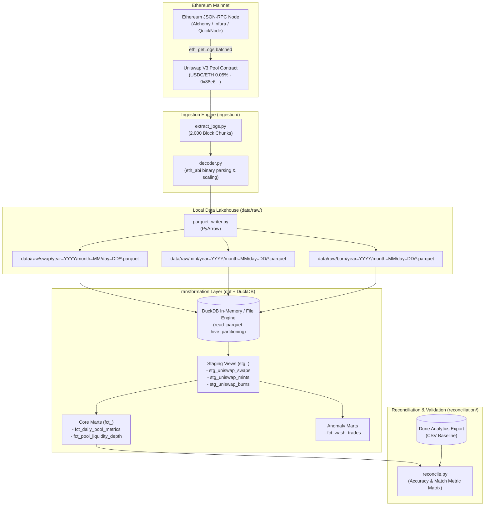

# Uniswap V3 On-Chain Data Lakehouse & Wash-Trade Detection Engine

An end-to-end on-chain data engineering and analytics solution. It extracts raw Ethereum event logs (`Swap`, `Mint`, `Burn`), decodes binary log data, persists structured records in a partitioned Parquet lakehouse, transforms data using **DuckDB** and **dbt**, flags bot activity and wash trading via heuristic window engines, and reconciles outputs against baseline **Dune Analytics** queries.

---

## Technical Architecture



---

## Directory Structure

```plaintext
uniswap_v3/
├── config/                               # Project configurations and contract ABIs
│   ├── abis/
│   │   └── uniswap_v3_pool.json          # Pool ABI covering Swap, Mint, Burn events
│   └── settings.py                       # Global paths, RPC endpoints, and defaults
├── data/                                 # Lakehouse storage (partitioned & git-ignored)
│   ├── raw/
│   │   ├── swap/                         # year=YYYY/month=MM/day=DD/*.parquet
│   │   ├── mint/                         # year=YYYY/month=MM/day=DD/*.parquet
│   │   └── burn/                         # year=YYYY/month=MM/day=DD/*.parquet
│   ├── lakehouse/                        # DuckDB database file storage
│   └── dune/                             # Baseline CSV exports from Dune Analytics
├── ingestion/                            # On-chain extraction and Parquet serialization
│   ├── __init__.py
│   ├── decoder.py                        # Binary topic & data decoding via eth_abi
│   ├── extract_logs.py                   # Batched eth_getLogs ingestion script
│   └── parquet_writer.py                 # PyArrow partitioned Parquet writer
├── transformations/                      # dbt project backed by dbt-duckdb
│   ├── dbt_project.yml                   # dbt project configuration
│   ├── profiles.yml                      # DuckDB connection profile
│   ├── macros/                           # Custom dbt SQL macros
│   ├── models/
│   │   ├── staging/
│   │   │   ├── stg_uniswap_swaps.sql     # Normalized swap logs (amounts, addresses)
│   │   │   ├── stg_uniswap_mints.sql     # Normalized mint logs (liquidity, ticks)
│   │   │   ├── stg_uniswap_burns.sql     # Normalized burn logs
│   │   │   └── schema.yml                # Primary key & nullability tests
│   │   └── marts/
│   │       ├── core/
│   │       │   ├── fct_daily_pool_metrics.sql     # Volume, fees, transaction counts
│   │       │   ├── fct_pool_liquidity_depth.sql   # Active tick net liquidity depth
│   │       │   └── schema.yml
│   │       └── anomalies/
│   │           ├── fct_wash_trades.sql   # Wash-trade & bot burst heuristic model
│   │           └── schema.yml
│   └── tests/
│       └── test_block_continuity.sql     # Test verifying sequential block integrity
├── reconciliation/                       # Verification against ground truth
│   ├── __init__.py
│   ├── reconcile.py                      # Local DuckDB vs. Dune Analytics comparator
│   └── dune_queries/
│       └── baseline_swaps.sql            # Reference Dune SQL query
├── .env.example                          # Environment variable template
├── .gitignore                            # Data, venv, and cache exclusions
├── prd.md                                # Product Requirement Document
├── requirements.txt                      # Python dependencies
└── README.md                             # Documentation & architecture overview
```

---

## Core System Components

### 1. Data Ingestion & Lakehouse (`ingestion/`)
- Queries Ethereum JSON-RPC nodes using `eth_getLogs` batched across 2,000-block intervals to avoid timeouts.
- Targets core Uniswap V3 events:
  - **`Swap`**: `Swap(address,address,int256,int256,uint160,uint128,int24)`
  - **`Mint`**: `Mint(address,address,int24,int24,uint128,uint256,uint256)`
  - **`Burn`**: `Burn(address,int24,int24,uint128,uint256,uint256)`
- Decodes topic parameters and binary data payloads using `eth_abi`, normalizing decimals (e.g. 6 decimals for USDC, 18 for WETH).
- Stores outputs in partitioned Parquet format: `data/raw/{event_type}/year=YYYY/month=MM/day=DD/*.parquet`.

### 2. Analytics Modeling with dbt + DuckDB (`transformations/`)
- Direct query access to Parquet partitions using DuckDB's `read_parquet(..., hive_partitioning=1)`.
- **Staging Layer (`stg_`)**: Generates composite primary keys (`tx_hash-log_index`), lowercases addresses, and casts timestamps.
- **Marts Layer (`fct_`)**:
  - `fct_daily_pool_metrics`: Aggregates volume, trader counts, mint/burn actions, and estimated swap fees.
  - `fct_pool_liquidity_depth`: Calculates cumulative net liquidity changes per tick range.
- **Data Quality & Testing**: Uniqueness, non-null checks, and custom block sequence continuity tests.

### 3. Heuristic Bot & Wash-Trade Detection Engine (`fct_wash_trades.sql`)
Identifies non-economic trading patterns using window functions (`LAG`, `COUNT OVER`):
- **Round-Trip Swaps (Self-Trading / Circular Swaps)**: Detects when the same address swaps $X \rightarrow Y$ and then $Y \rightarrow X$ within $\le 3$ blocks with near-zero net position change.
- **High-Frequency Bursts**: Flags wallets initiating $> 3$ swaps within a single block or adjacent blocks ($< 12$ seconds).
- **Volume Inflation vs. MEV Arbitrage**: Isolates non-economic wash trading where sender and recipient map back to the same entity.

### 4. Dune Analytics Reconciliation Suite (`reconciliation/`)
- Compares DuckDB aggregated mart outputs against baseline Dune Analytics queries for the identical block window.
- Calculates precision match metrics across:
  - Total Daily Swap Volume
  - Unique Active Traders
  - Identified Wash-Trading Addresses
- Outputs match accuracy percentages (e.g. `99.4% match`).

---

## Quickstart & Setup Guide

### 1. Prerequisites
- Python 3.10+
- Access to an Ethereum Mainnet RPC node (Alchemy, Infura, QuickNode, or local geth node)

### 2. Environment Setup
```bash
# Create and activate a Python virtual environment
python -m venv venv

# On Windows:
.\venv\Scripts\Activate.ps1
# On macOS / Linux:
# source venv/bin/activate

# Install required packages
pip install -r requirements.txt
```

### 3. Configure Environment Variables
Copy `.env.example` to `.env` and fill in your RPC credentials:
```bash
cp .env.example .env
```
Key variables:
- `RPC_URL`: Your Ethereum JSON-RPC provider endpoint.
- `POOL_ADDRESS`: Target Uniswap V3 Pool contract (`0x88e6a0c2ddd26feeb64f039a2c41296fcb3f5640` for USDC/ETH 0.05%).
- `START_BLOCK` / `END_BLOCK`: Target block window to extract.

### 4. Run Ingestion
```bash
python ingestion/extract_logs.py
```
Decoded logs will be saved as partitioned Parquet files under `data/raw/{swap,mint,burn}/`.

### 5. Run dbt Transformations & Data Quality Tests
```bash
cd transformations

# Run dbt transformations with DuckDB
dbt run --profiles-dir .

# Run dbt schema and continuity tests
dbt test --profiles-dir .

cd ..
```

### 6. Run Baseline Reconciliation
1. Run `reconciliation/dune_queries/baseline_swaps.sql` on Dune Analytics for your extracted block window.
2. Export the query results as CSV and place it in `data/dune/`.
3. Execute the reconciliation script:
```bash
python reconciliation/reconcile.py
```

---

## License
Distributed under the MIT License. See [LICENSE](file:///C:/BetaProj/Project/uniswap_v3/LICENSE) for more information.
